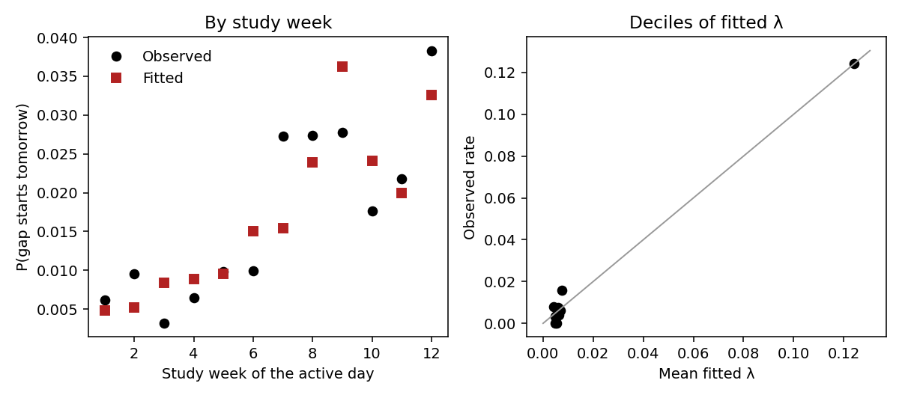
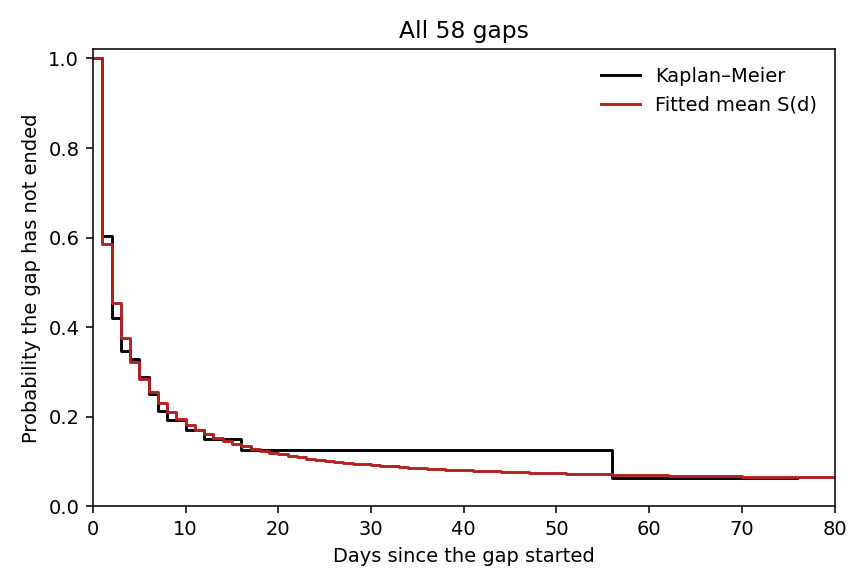
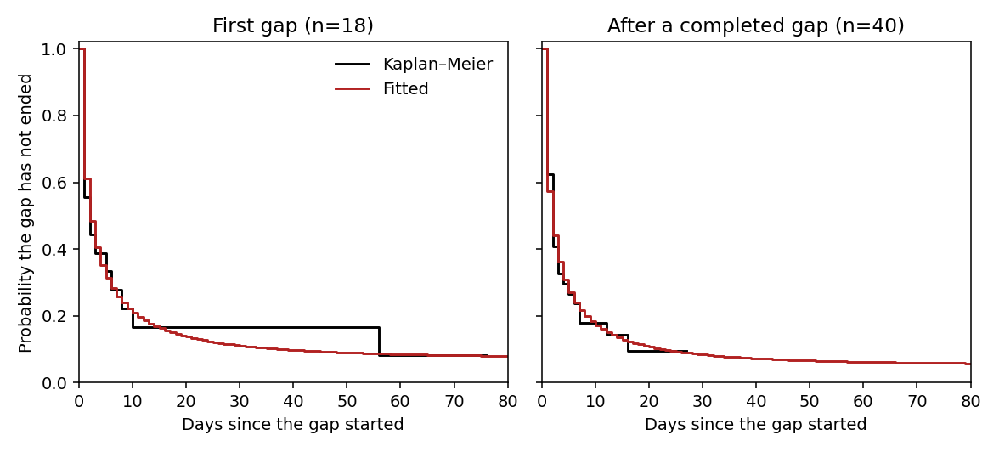
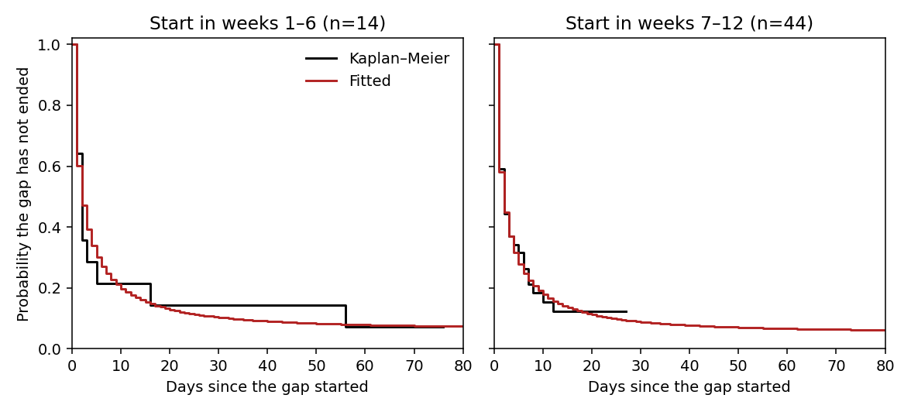
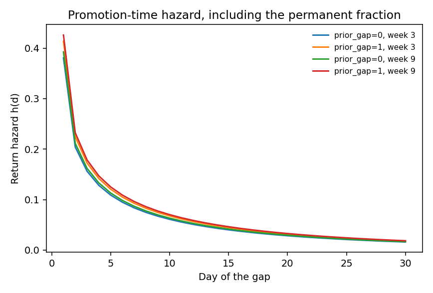

# Activity process fit (2026-10-20)

Two transition models on daily activity for the 47 modelled participants.
The process is exogenous: no latent perceived utility and no action terms.
Scripts 1–5 were not rerun. The simulator and the 4b likelihood filter are not in this fit.

## Data

Source: `docs/dropout_check_20261017/participant_dropout_daily.csv`, restricted with `in_modelled_47` in `participant_dropout.csv`.
`active_d` is a page view, wear, or a daily or weekly survey submission on that local day.
Study day 1 is the first local end-of-day date and is active.
The fit window is protocol weeks 1–12 (Monday–Sunday): days 1–84 for the 20 Monday starters,
and days 2–85 for the 27 Sunday starters. Study day 1 of a Sunday starter is the partial
week-0 Sunday. It is history for `act7` and is not inside a gap. `study_day` and `dropout_day` are unchanged.
A gap is a run of inactive days inside that window. It is ended when an active day follows inside the window;
otherwise it is censored at the week-12 Sunday. A Sunday starter's gap may begin on day 2.

| Check | Value |
|---|---:|
| Modelled users | 47 |
| Gaps | 58 (49 ended, 9 censored) |
| Users with / without a gap | 18 / 29 |
| Active person-days in the model 1 risk set | 3537 |
| Gap starts in that risk set | 58 |

The risk set is an observed active day inside the window whose next day is also in the window.
The censored lengths are 1, 1, 3, 9, 12, 23, 24, 27, 76.
A gap may start on the window's first day for a Sunday starter; that gap is in model 2 and not in the model 1 risk set.
None of the fitted gaps start there. The previous protocol-week fit, with activity equal to page view or wear only,
had a risk set of 3536 and 57 gaps (48 ended, 9 censored; censored lengths 1, 1, 3, 9, 12, 23, 24, 27, 76).
This fit uses the same weeks. The one added gap is user 248: study day 55 (2026-05-02) is a survey submission
with no page view and no wear, so it was inactive before. It splits one ended 3-day gap (days 54–56) into
two ended 1-day gaps. The censored lengths are unchanged, and the risk set gains that Saturday.

`week` is the protocol study week, `study_week_norm(week, n_weeks=12)` = (week − 6.5) / 5.5,
not `ceil(study_day/7)`. A Monday-start simulator episode uses the same week, because its day 1 is Monday.
`act7` is the fraction of the previous seven days that were active. Days before study day 1 count as active.
The observed week-0 Sunday is used when it falls in those seven days.
`prior_gap` becomes 1 on the day activity resumes and stays 1. That is the simulator rule
("on return, set prior_gap = 1"), so the return day itself already carries it.

## Model 1: active → inactive

One row per active day `d` with day `d+1` observed. Outcome: day `d+1` is inactive.
Logistic maximum likelihood, cluster-robust standard errors by participant.

Intercept-only rate λ̄ = 0.0164 per active day (cluster SE 0.0049; logit intercept -4.094, SE 0.302).
Crude rate 58/3537 = 0.0164.
Among days with `prior_gap = 0`, the first-gap rate is 0.0056 (18 events / 3215 days).

| Term | Coefficient | Cluster SE | Odds ratio | 95% CI | p |
|---|---:|---:|---:|---|---:|
| intercept | -0.569 | 0.988 | 0.566 | 0.082–3.926 | 0.565 |
| week | 0.290 | 0.274 | 1.336 | 0.781–2.284 | 0.290 |
| act7 | -4.604 | 0.953 | 0.010 | 0.002–0.065 | 0.000 |
| prior_gap | 1.867 | 0.491 | 6.470 | 2.472–16.934 | 0.000 |

Joint Wald test of the three slopes, using the cluster covariance: statistic 138.15 on 3 df, p = 0.000.
Log likelihood -198.6 versus -295.9 for the intercept-only model.

Reference predictions from the fitted logit:

| Week norm | act7 | prior_gap | Fitted λ |
|---:|---:|---:|---:|
| 0.00 | 1.0 | 0 | 0.0056 |
| 0.00 | 1.0 | 1 | 0.0354 |
| 0.00 | 0.5 | 1 | 0.2681 |
| 1.00 | 1.0 | 0 | 0.0075 |
| -1.00 | 1.0 | 0 | 0.0042 |

### Calibration

Fitted probabilities against the observed gap-start rate. Week is the study week of the active day.

| Week | Days | Events | Observed | Fitted |
|---:|---:|---:|---:|---:|
| 1 | 323 | 2 | 0.0062 | 0.0048 |
| 2 | 313 | 3 | 0.0096 | 0.0052 |
| 3 | 315 | 1 | 0.0032 | 0.0084 |
| 4 | 311 | 2 | 0.0064 | 0.0089 |
| 5 | 306 | 3 | 0.0098 | 0.0095 |
| 6 | 302 | 3 | 0.0099 | 0.0150 |
| 7 | 293 | 8 | 0.0273 | 0.0155 |
| 8 | 292 | 8 | 0.0274 | 0.0240 |
| 9 | 288 | 8 | 0.0278 | 0.0363 |
| 10 | 284 | 5 | 0.0176 | 0.0241 |
| 11 | 275 | 6 | 0.0218 | 0.0199 |
| 12 | 235 | 9 | 0.0383 | 0.0326 |

| Decile | Days | Observed | Mean fitted | Fitted range |
|---:|---:|---:|---:|---|
| 1 | 625 | 0.0080 | 0.0043 | 0.0042–0.0045 |
| 2 | 294 | 0.0034 | 0.0047 | 0.0047–0.0047 |
| 3 | 287 | 0.0000 | 0.0049 | 0.0049–0.0049 |
| 4 | 286 | 0.0035 | 0.0052 | 0.0052–0.0052 |
| 5 | 280 | 0.0000 | 0.0055 | 0.0055–0.0055 |
| 6 | 526 | 0.0076 | 0.0059 | 0.0058–0.0061 |
| 7 | 249 | 0.0040 | 0.0064 | 0.0064–0.0064 |
| 8 | 480 | 0.0063 | 0.0069 | 0.0068–0.0071 |
| 9 | 188 | 0.0160 | 0.0075 | 0.0075–0.0075 |
| 10 | 322 | 0.1242 | 0.1242 | 0.0281–0.8303 |

## Model 2: inactive → active, with a permanent fraction

Promotion-time cure model on the 58 gaps. Discrete Weibull kernel `F(d) = 1 - exp(-(d/μ)^α)`,
`S(d) = exp(-θ F(d))`, `π = exp(-θ)`. Covariates sit on `log θ` at the gap-start day;
`F` has no covariates. An ended gap of length `t` contributes `S(t-1) - S(t)`; a gap still open
after `c` days contributes `S(c)`.

Numerical maximum likelihood from 10 starts. 10 starts landed on this solution (log likelihood -115.58).
Hessian standard errors treat the 58 gaps as independent. They are too small: the gaps come from 18 people.
No bootstrap and no profile interval. The simulator uses the point estimates.

| Parameter | Estimate | Hessian SE |
|---|---:|---:|
| c0 | 0.954 | 0.346 |
| c1 (prior_gap) | 0.108 | 0.343 |
| c2 (week at gap start) | 0.036 | 0.294 |
| μ | 11.379 | 8.703 |
| α | 0.643 | 0.118 |

μ and α standard errors are the delta method from the SEs of log μ and log α.
α < 1, so the Weibull return hazard is decreasing.
c1 and c2 are smaller than those standard errors. π barely moves with prior gap or with the week the gap starts.
μ itself is imprecise relative to its point estimate.

### Fitted survival against Kaplan–Meier

The fitted curve in each panel is the average of `S(d | x_i)` over the gaps in that panel,
not the survival at the average covariate.

The overall curve follows the Kaplan–Meier through the first two weeks and ends on the same plateau.
Between the early returns and user 112's day-56 return the data are flat while the Weibull keeps declining;
that is the proportional-hazards constraint, which ties return speed to π.
The first-gap panel is where that stretch shows. Later gaps and late starts sit on the fitted curve,
and the strata do not separate much, in line with the small c1 and c2.

### Sufficient follow-up

Maller–Zhou (1994): `t_n` is the largest gap time, censored gaps included; `t*_n` is the largest
ended gap; `N_n` counts ended gaps in `(2 t*_n - t_n, t*_n]`; `q_n = N_n / n`.
The second column drops user 112's ended 56-day gap and does not refit.

| | All 58 gaps | Without 112's 56-day gap |
|---|---:|---:|
| n | 58 | 57 |
| t_n | 76 | 76 |
| t*_n | 56 | 16 |
| N_n | 1 | 48 |
| q_n | 0.017 | 0.842 |
| S_KM(t_n) | 0.063 | 0.107 |
| Greenwood 95% CI | -0.036–0.161 | 0.018–0.195 |

S_KM(t_n) > 0 because the largest recorded gap time is censored.
The Greenwood interval includes 0 when the 56-day return is kept and excludes 0 when that gap is dropped.
Maller and Zhou (1992) read a positive plateau at the largest time as evidence of a permanent fraction
when follow-up reaches past the return distribution. With the 56-day return included, q_n is 1/58:
that single late return sets the plateau. Without it, q_n is large because the next longest ended gap
is much shorter than the longest censored gap, so the follow-up window covers essentially every return.
The fit keeps 112.

### Permanent fraction, return hazard, and the 14-day count

`π(x)` below is evaluated at prior_gap 0/1 and at week 3 or week 9 (the middle of weeks 1–6 and 7–12).
The median is the gap length among people who do return, from `S_u`.

| Covariates | θ | π | Median length if they return |
|---|---:|---:|---:|
| prior_gap=0, week 3 | 2.538 | 0.079 | 2 |
| prior_gap=1, week 3 | 2.827 | 0.059 | 2 |
| prior_gap=0, week 9 | 2.640 | 0.071 | 2 |
| prior_gap=1, week 9 | 2.940 | 0.053 | 2 |

Average of π_i over the 58 observed gaps: 0.060.

`h(d) = 1 - S(d)/S(d-1)` includes the permanent fraction, so it falls toward 0 even if returners
would still come back. Selected days:

| Day | prior_gap=0, week 3 | prior_gap=1, week 3 | prior_gap=0, week 9 | prior_gap=1, week 9 |
|---:|---:|---:|---:|---:|
| 1 | 0.381 | 0.414 | 0.393 | 0.426 |
| 2 | 0.204 | 0.225 | 0.211 | 0.232 |
| 3 | 0.156 | 0.172 | 0.162 | 0.179 |
| 7 | 0.084 | 0.093 | 0.087 | 0.096 |
| 14 | 0.043 | 0.048 | 0.045 | 0.050 |
| 30 | 0.016 | 0.018 | 0.017 | 0.019 |

For each gap still open at the week-12 Sunday, `P(permanent | open c days) = π / S(c)`.

| User | Open days | Start week | prior_gap | π | S(c) | P(permanent) | 14-day rule |
|---:|---:|---:|---:|---:|---:|---:|---|
| 106 | 1 | 12 | 1 | 0.050 | 0.568 | 0.088 | no |
| 291 | 1 | 12 | 1 | 0.050 | 0.568 | 0.088 | no |
| 361 | 3 | 12 | 1 | 0.050 | 0.355 | 0.141 | no |
| 257 | 9 | 11 | 1 | 0.051 | 0.179 | 0.284 | no |
| 112 | 12 | 11 | 1 | 0.051 | 0.147 | 0.347 | no |
| 259 | 23 | 9 | 1 | 0.053 | 0.097 | 0.543 | yes |
| 82 | 24 | 9 | 0 | 0.071 | 0.121 | 0.592 | yes |
| 138 | 27 | 9 | 1 | 0.053 | 0.088 | 0.598 | yes |
| 379 | 76 | 2 | 0 | 0.080 | 0.087 | 0.919 | yes |

Sum of these 9 probabilities: **3.60** expected permanent gaps.
The 14-day rule calls 4 of these gaps dropouts (259, 82, 138, 379; lengths 23, 24, 27, 76).

The long-gap tail of model 2 rests on one return (112, day 56): the Weibull declines
over days 16–56 where the Kaplan–Meier is flat, which lowers P(permanent) for the
23–27-day gaps to 0.54–0.60 and makes 3–4-week temporary gaps more frequent in simulation
(simulated 90th percentile 33 versus 56 in the data).
Aggregate dropout is calibrated (3.60 versus 4; 9.4% versus 8.5%).

λ̄ × (average π over the 58 gaps) = 0.098% per active day.
λ̄ × π × the active-day fraction (0.906) is 0.089% per person-day.
The constant-hazard calibration is 0.105% per person-day (4/3809).
The person-day rates use that same denominator.

## Paths simulated from the fitted process

10,000 independent 84-day paths. Day 1 starts active. Covariates are computed from the path itself,
with the fitting week scale `n_weeks=12`. A permanent draw stays inactive through day 84 and is
censored for the gap-length comparison, as an open gap is in the data.

| Quantity | Data (47 people) | Simulated paths |
|---|---:|---:|
| Mean gaps per person | 1.23 | 1.33 |
| Proportion with 0 gaps | 0.617 | 0.621 |
| Proportion with 1 gap | 0.170 | 0.109 |
| Proportion with 2 gaps | 0.043 | 0.065 |
| Proportion with 3 or more | 0.170 | 0.205 |
| Ended-gap length, median | 2.0 | 2.0 |
| Ended-gap length, 75th | 3.0 | 4.0 |
| Ended-gap length, 90th | 7.2 | 9.0 |
| Kaplan–Meier median length | 2.0 | 2.0 |
| Kaplan–Meier 90th percentile | 56.0 | 33.0 |
| Fraction of inactive days | 0.094 | 0.098 |
| Terminal gap of 14 days or more | 0.085 | 0.094 |

Monte Carlo standard errors at n = 10000 are about 0.005 for a proportion near 1/2 and smaller for rarer events.
The zero-gap share, the median ended gap, the inactive-day fraction, and the 14-day terminal share
are the close comparisons. The data Kaplan–Meier 90th percentile is the single day-56 return;
the simulated paths put fewer people on exactly one gap and more on three or more.
The latent fraction permanently gone by day 84 in these paths is 0.083.
That fraction is not observed in the data; the 14-day row above is the comparable quantity.

### 36-week extrapolation

Separate 10,000 paths of 252 days. Week is stretched with `n_weeks=36`, which is what the simulator
will pass for a 36-week horizon. Week 12 then sits at -0.37 rather than at 1, so this is not the fitted 84-day covariate scale.
Fraction permanently gone by day 252: **0.337**.
The stored constant-hazard extrapolation over the same horizon is 0.233 (`dropout_cumulative_day252`).
The 36-week figure is driven by prior_gap (odds ratio 6.5, permanent once set):
event dependence and stayer heterogeneity are not distinguishable in 84 days
(see the time-to-first-gap Kaplan–Meier). This is an assumption-driven extrapolation.
The simulated share with 3 or more gaps (0.20 versus 0.17)
suggests prior_gap slightly overstates event dependence.
The week slope is also being used outside the fitted range of calendar weeks even though
the normalized covariate stays in [−1, 1].

## Parameters written for the simulator

`env_para_vanilla/generator_calibration.json`, key `activity_process`. Existing `dropout_*` keys are unchanged.
Model 1 coefficients are intercept, week, act7, prior_gap. Model 2 stores c0, c1, c2, μ, α.

The local 4b run on 2026-10-19 (`python 4b_perceived_utility_bayes.py --chains 4 --cores 4 --tune 2000 --draws 3000 --target-accept 0.95`, finished 21:12) predates the active-day filter and is not used. `env_para_vanilla/` was restored to commit `65a9fed`, plus the `activity_process` block.

## Simulator check

The episode draws the activity path once, before the day loop, from the dropout
RNG stream (`SeedSequence` `[episode seed, participant, 771337]`). The same stream
is the legacy constant-hazard draw when no activity record is loaded. The path is
two days longer than the episode so the last Sunday's Monday and Tuesday are known.
`lambda = 0` is all active and does not draw on that stream. The main episode RNG
is `numpy.random.seed(episode seed)` and does not include the participant.
Users 13, 22, and 18 with episode seed 1, on a 252-day path: 13: dropout day 94, 6 gaps, 165 inactive days; 22: dropout day 202, 1 gap, 51 inactive days; 18: dropout day -1, 0 gaps, 0 inactive days.

The table is 2000 paths from that seeding. The modelled participants cycle through
the uid slot, and the episode seed starts at 20261022 (84 days, `n_weeks=12`) or
20261023 (252 days, `n_weeks=36`) and increases after each full pass. The middle
column is the Step 1 validation (10,000 paths from one shared stream, seeds
20261020 and 20261021).

| Quantity | Data (47 people) | 10,000 paths | 2000 paths |
|---|---:|---:|---:|
| Mean gaps per person | 1.23 | 1.33 | 1.26 |
| Proportion with 0 gaps | 0.617 | 0.621 | 0.623 |
| Proportion with 1 gap | 0.170 | 0.109 | 0.119 |
| Proportion with 2 gaps | 0.043 | 0.065 | 0.064 |
| Proportion with 3 or more | 0.170 | 0.205 | 0.195 |
| Ended-gap length, median | 2.0 | 2.0 | 2.0 |
| Ended-gap length, 75th | 3.0 | 4.0 | 4.0 |
| Ended-gap length, 90th | 7.2 | 9.0 | 9.0 |
| Kaplan–Meier 90th percentile | 56.0 | 33.0 | 34.0 |
| Fraction of inactive days | 0.094 | 0.098 | 0.094 |
| Terminal gap of 14 days or more | 0.085 | 0.094 | 0.092 |
| Latent permanent by day 84 | — | 0.083 | 0.083 |
| Latent permanent by day 252 | — | 0.337 | 0.346 |

At n = 2000 a proportion near 0.10 has a Monte Carlo standard error of about 0.007,
and a proportion near 0.60 has one of about 0.011. The 2000-path column sits on the
10,000-path column inside that noise. The Step 1 conclusions are unchanged:
the long-gap tail is still the day-56 return, and aggregate dropout stays next to
the 14-day count. The Step 1 constant-hazard extrapolation to day 252 is 0.233.
